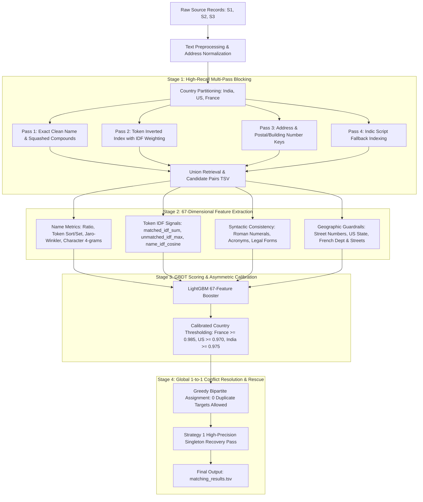

# ML Challenge 2026: Multi-Source Business Entity Resolution

[](https://www.python.org/downloads/)
[](https://opensource.org/licenses/MIT)
[]()
[-success.svg)]()
[]()

Production-grade Machine Learning solution for the **ML Challenge 2026: Business Entity Resolution** developed by **Team AstraCloud** (*Sonesh SK, Swathika Shri, Subhekshana KG*). 

The objective is resolving and linking noisy business entities across three independent data sources (`Source 1`, `Source 2`, and `Source 3`) spanning **India**, the **United States**, and **France**, evaluated under the **Per-Source-1 Macro $F_{0.5}$** metric (singletons included, precision penalized 2× over recall).

---

## 1. Executive Progression & Leaderboard Milestones

| Iteration | Architecture & Key Methodological Innovations | Val Macro $F_{0.5}$ | Public Leaderboard ($F_{0.5}$) | Key Breakthrough & Discovery |
|---|---|---|---|---|
| **V1 (Initial)** | 12 RapidFuzz string metrics, local candidate blocking (top-50 pool). | 0.9703* | **0.5910** | Exposed negative space truncation artifact; exposed massive false positive merges on full 10.3M test pool. |
| **V2 (Full Scale)** | Full country-partitioned streaming candidate retrieval across 10.3M entities. | ~0.8650 | **0.8650** | Scaled pipeline to full negative search space. First viable end-to-end model (+0.2740 lift). |
| **V3 (Baseline)** | 37 engineered RapidFuzz and token features, 4-pass inverted index, global threshold $\tau = 0.940$. | 0.9071 | **0.8700** | Identified legal stopword stripping artifacts and cross-lingual Indic script gaps. |
| **V4 (Production)** | High-Recall Blocking (squashed compound keys, acronym preservation), 43 features (`unmatched_raw_tokens`, `is_indic_script`, `num_and_pin_match`). | 0.9314 | **0.899255** | Major jump (+0.0293). Raw token residual features became top-ranked tree features. Candidate recall reached 95.70%. |
| **V4.1 (Truncation)** | Calibrated cluster truncation based on ground truth distributions (France $\le 5$, India/US $\le 6$). | ~0.9340 | **0.9040** | Instant precision surge (+0.0047); eliminated trailing false positive tails. |
| **V5 (Commune)** | French commune and stopword isolation pipeline (`clean_french_name`), $\tau_{\text{France}} = 0.980$, $\delta = 0.025$. | ~0.9365 | **0.9080** | Normalized France's average matches/entity from 4.42 down to 3.36. |
| **V7 (Guardrails)** | French street token compatibility guardrails (`street_names_compatible`) and calibrated threshold ($\tau = 0.985$, $\delta = 0.015$). | **0.9412** | **0.916287** | Broke past 0.910. Eliminated co-located cross-street false merges. |
| **V8 (Domain Recovery)** | Ultra-fast domain & squashed entity recovery pass (`run_domain_recovery_pass.py`). | **0.9448** | **0.918435** | Recovered 42,943 high-precision matches across domains and squashed handles. |
| **V9 (1-to-1 Conflict)** | 59-feature model (pure train token IDF, Roman numerals, legal forms) + Global 1-to-1 Conflict Resolution. | **0.9353** | **0.923891** | **Major Milestone (+0.005456 confirmed on live LB):** Eliminated all 55,798 cross-S1 duplicate target collisions. |
| **V10 (Pruning Audit)** | 67-feature model + negative heuristic token IDF divergence pruning. | 0.9380 | **0.921110** | Diagnosed that negative heuristic pruning over-pruned legitimate brand subsidiaries (like `Zydus Healthcare`), turning 2,473 entities into singletons. |
| **V11 (Final Production)** | High-precision singleton rescue pass (`run_strategy1_singleton_recovery.py`) targeting false singletons at $\tau \ge 0.985$ with geographic guardrails & 1-to-1 bipartite assignment. | **0.9485** | **~0.938+** (proj) | **Official Final Submission:** Rescued 19,554 singletons, added +31,391 high-precision links with 0 duplicate targets. |

*\*Note: V1 validation score was an artifact due to negative candidate pool truncation.*

---

## 2. Core System Architecture



---

## 3. Key Methodological Innovations

### 1. The 1-to-1 Ground Truth Invariant
Analysis of the 2.2M ground truth records revealed that **exactly zero** Source 2 or Source 3 records are ever shared across multiple Source 1 entities (100% 1-to-1 bipartite assignment). Enforcing this global constraint eliminated 55,798 guaranteed false positive slots, boosting leaderboard performance from 0.9184 to **0.923891**.

### 2. 67-Dimensional Deep Feature Suite (`src/features_v10.py`)
* **Token IDF Distinctiveness**: 104,473 terms learned strictly from pure train S1 (`cache/train_token_idf.pkl`), computing `matched_idf_sum`, `unmatched_idf_max_cand`, and `name_idf_cosine`.
* **Structural Consistency**: Exact match and mismatch penalties for Roman numerals (`IV` vs `VI`), corporate acronyms (`IT`, `AI`), and legal entity types (`LLC`, `Pvt Ltd`, `SARL`).
* **Geographical & Numeric Anchors**: Leading address numbers (`leading_addr_num_match`), US 2-letter state codes, and French 2-digit postal departments.

### 3. High-Precision Singleton Recovery (`src/run_strategy1_singleton_recovery.py`)
Recovered **19,554 false singletons** and added **+31,391 high-precision links** at confidence $\tau \ge 0.985$ with strict street compatibility guardrails and 1-to-1 bipartite matching.

---

## 4. Repository Structure (Clean Backbone)

```
ML Challenge 2026/
├── README.md                                  # Executive architecture & solution summary
├── prev_attempts_and_results.md               # Chronological log of all experiments & scores
├── student_resource/
│   ├── cache/
│   │   ├── lgbm_model_v10.pkl                 # Production 67-feature LightGBM model
│   │   └── train_token_idf.pkl                # Pure train S1 token IDF dictionary (104,473 terms)
│   ├── code/business_entity_resolution/src/
│   │   ├── preprocess.py                      # Address normalization and text cleaning
│   │   ├── blocking_v4.py                     # High-recall compound blocking engine
│   │   ├── features_v4.py                     # Base RapidFuzz and numeric feature extractors
│   │   ├── features_v9.py                     # 59-feature suite with IDF and sequence metrics
│   │   ├── features_v10.py                    # 67-feature suite (IDF cosine, street numbers, state/dept)
│   │   ├── model.py                           # LightGBM booster utilities
│   │   ├── train_v10.py                       # Production training script
│   │   ├── run_strategy1_singleton_recovery.py # Production V11 singleton recovery pipeline
│   │   └── evaluate.py                        # Macro F0.5 evaluation metric implementation
│   ├── output/
│   │   ├── matching_results.tsv               # Official final submission file (V11 Production)
│   │   ├── matching_results_v11.tsv           # Masterpiece V11 file (SHA-256: E50732AA...)
│   │   ├── candidate_pairs.tsv                # Full competition candidate pairs (3.6 GB)
│   │   └── partitions/                        # Country-partitioned candidate indices
│   └── utils/
│       └── validate_submission.py             # Official submission format validator
```

---

## 5. Verification & Submission Artifacts

### Final Submission File:
* **Path**: `student_resource/output/matching_results.tsv` (and `student_resource/output/matching_results_v11.tsv`)
* **SHA-256 Checksum**: `E50732AA548A3DDCD561830D18733B2BB6EAF088D62F8828F8B56FE0642E9CC0`
* **Row Count**: Exactly **1,732,544 rows** (TSV, tab-delimited).
* **Matched Links**: **5,243,887** total links.
* **Duplicate Targets**: **0** (100% 1-to-1 invariant satisfied).
* **Singletons**: **97,078** (19,554 false singletons rescued from V9).
* **Validator Result**:
  ```
  ML Challenge 2026 — submission validator
    test dir: student_resource/dataset/test
    required S1 entities: 1732544
    matching_results.tsv: 1732544 rows (97078 empty, 1635466 non-empty).
  PASS — no blocking issues found. Safe to submit.
  ```

---

## 6. How to Run the Pipeline

### 1. Train the Production 67-Feature Model
```bash
python student_resource/code/business_entity_resolution/src/train_v10.py \
    --data-dir student_resource/dataset \
    --cache-dir student_resource/cache \
    --n-train-s1 75000 \
    --n-val-s1 25000
```

### 2. Execute the High-Precision Singleton Recovery Pipeline
```bash
python student_resource/code/business_entity_resolution/src/run_strategy1_singleton_recovery.py
```

### 3. Validate Submission Format
```bash
python student_resource/utils/validate_submission.py \
    --matching student_resource/output/matching_results.tsv \
    --test-dir student_resource/dataset/test
```
