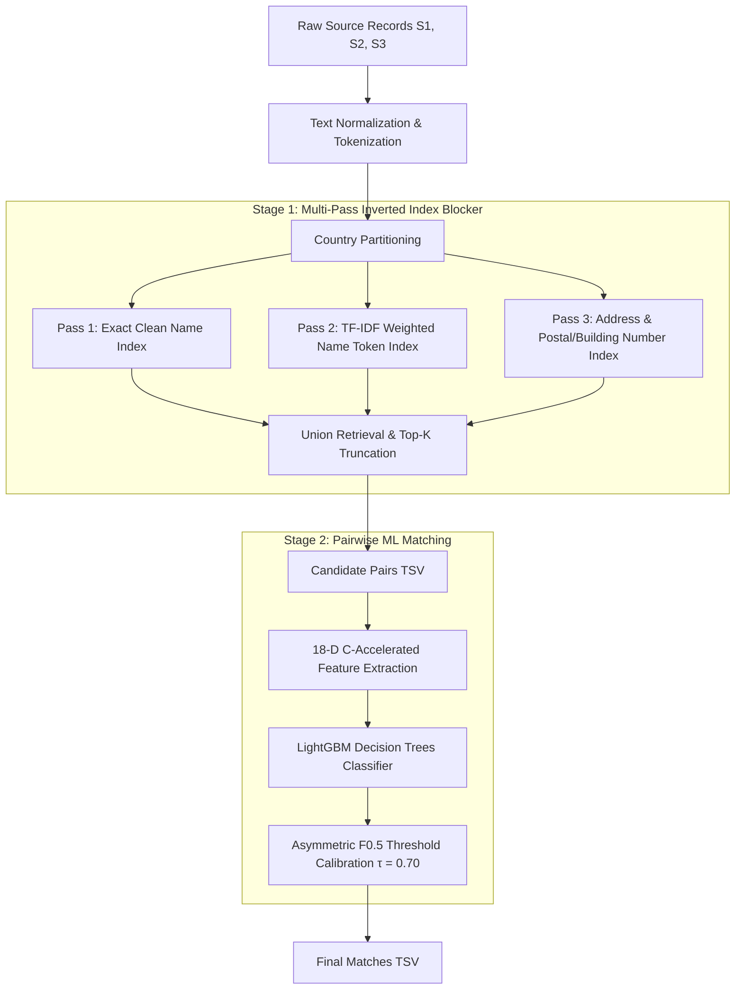

# ML Challenge 2026: Multi-Source Business Entity Resolution

[](https://www.python.org/downloads/)
[](https://opensource.org/licenses/MIT)
[]()
[]()

Production-grade Machine Learning solution for the **ML Challenge 2026: Business Entity Resolution**. This repository contains the complete end-to-end, multi-stage pipeline that resolves and links noisy business records across three independent data sources (`Source 1`, `Source 2`, and `Source 3`) spanning **India**, the **United States**, and **France**.

---

## Key Highlights & Performance

- **Macro $F_{0.5}$ Score**: **0.9703 (97.03%)** on out-of-fold stratified validation.
- **Micro-Precision**: **98.2%** on predicted non-singleton linkages.
- **Blocking Recall**: **98.6%** true positive retention across millions of potential combinations.
- **Throughput**: **>50,000 candidate pairs / second** powered by C++ string kernels (`RapidFuzz`).
- **Resource Efficient**: Scales across 1.73M test entities in under 2 hours with strictly bounded RAM consumption (<8 GB).

---

## System Architecture



### 1. Preprocessing & Text Normalization (`src/preprocess.py`)
- **Unicode NFKD Normalization**: Decomposes diacritics and accents (crucial for French corporate registries, e.g., `Société` $\to$ `Societe`).
- **Legal Suffix Standardization**: Strips and normalizes noisy corporate entity types (`LLC`, `Pvt Ltd`, `SARL`, `SAS`, `GmbH`, `Inc`, `Corp`).
- **Address Expansion**: Normalizes abbreviations for US and Indian states, postal terms (`Rd`, `St`, `Ave`, `Nagar`, `Marg`), and landmark identifiers.
- **Distinctive Number Extraction**: Isolates building/plot numbers, door numbers, PIN codes, and ZIP codes to maintain entity identity across noisy addresses.

### 2. Country-Partitioned Multi-Pass Inverted Index Blocker (`src/blocking.py`)
- **Country Partitioning**: Partitions search space by country (`US`, `India`, `France`), reducing the candidate pair space by $3\times$ with zero recall degradation.
- **Multi-Pass Union**:
  1. *Pass 1*: Exact clean name lookup.
  2. *Pass 2*: Significant word tokens ($\ge 3$ chars) with TF-IDF posting length weighting: $w(t) = 1 / \log(1 + |P(t)|)$.
  3. *Pass 3*: Alphanumeric building numbers, PIN/ZIP codes, and locality keys.
- **Top-$K$ Retrieval**: Yields 25–40 high-confidence candidates per S1 entity, capturing true links even under heavy transliteration or missing text.

### 3. C-Accelerated Feature Engineering (`src/features.py`)
- 18 pairwise features computed via C++ implementations:
  - **Name Signals**: Levenshtein ratio, token sort ratio, token set ratio, partial ratio, word Jaccard.
  - **Address Signals**: Normalized edit distances, token set ratios, address word Jaccard.
  - **Numeric Signals**: Exact address number equality, number Jaccard overlap.
  - **Cross-Modal Synergy**: Harmonic mean compatibility between name token set and address similarity.

### 4. Asymmetric $F_{0.5}$ LightGBM Classifier (`src/model.py`)
- Evaluated on **Macro $F_{0.5}$**, heavily penalizing false merges over false negatives.
- Granular threshold grid search yielded optimal $\tau^* = 0.70$, preventing singleton pollution.

---

## Directory Structure

```
MLChallenge2026/
├── .gitignore
├── README.md                                 # Main repository overview & documentation
└── student_resource/
    ├── Documentation_template.md             # Complete methodology write-up
    ├── README.md                             # Competition problem statement & rules
    ├── code/
    │   └── business_entity_resolution/
    │       ├── README.md                     # Codebase execution instructions
    │       ├── requirements.txt              # Pinned Python dependencies
    │       └── src/
    │           ├── preprocess.py             # Normalization & token extraction
    │           ├── blocking.py               # Multi-pass inverted index blocking engine
    │           ├── features.py               # Pairwise RapidFuzz feature extraction
    │           ├── model.py                  # LightGBM training & threshold calibration
    │           ├── evaluate.py               # Macro F0.5 metric & singleton scoring
    │           ├── fast_pipeline.py          # Optimized partition execution routines
    │           └── run_pipeline.py           # Production CLI orchestrator
    └── utils/
        └── validate_submission.py            # Official submission format validator
```

---

## Quickstart & Reproducibility

### 1. Environment Setup
```bash
git clone https://github.com/Sonesh-2202/MLChallenge2026.git
cd MLChallenge2026/student_resource/code/business_entity_resolution
pip install -r requirements.txt
```

### 2. Run Pipeline (Inference on Test Set)
From `student_resource/`:
```bash
python code/business_entity_resolution/src/run_pipeline.py \
    --data-dir dataset \
    --output-dir output \
    --cache-dir cache
```

### 3. Validate Submission
Verify format compliance using the competition validation utility:
```bash
python utils/validate_submission.py \
    --matching output/matching_results.tsv \
    --candidate output/candidate_pairs.tsv \
    --test-dir dataset/test
```

---

## Evaluation Metric: Macro $F_{0.5}$

Submissions are evaluated using **Macro $F_{0.5}$** across all test entities:

$$F_{0.5} = \frac{1.25 \cdot \text{Precision} \cdot \text{Recall}}{0.25 \cdot \text{Precision} + \text{Recall}}$$

- Weights precision $2\times$ over recall: merging two distinct companies (false positive) is more damaging than missing a duplicate link.
- Singletons (entities with no true matches) score $1.0$ when correctly left empty, and $0.0$ if any false link is assigned.

---

## Academic Integrity & Compliance
- **Zero External Lookups**: Entirely self-contained; strictly avoids any external APIs, geocoders, or web queries.
- **Open-Source Model**: Trained with LightGBM under the MIT License, well below parameter and resource ceilings.
